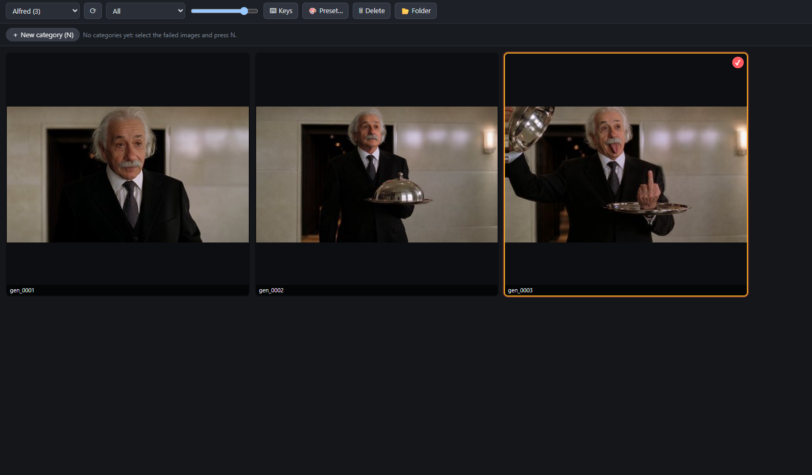
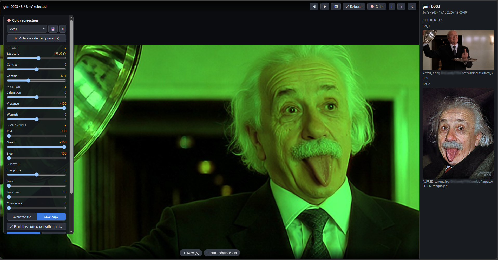
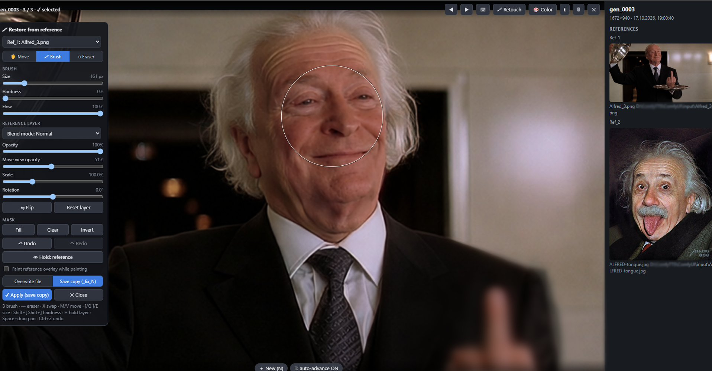

# ComfyUI-GenArchive (українською)

Облік кожної згенерованої картинки **разом з референсами, з яких вона створена**, швидкий повноекранний переглядач, сортування невдалих кадрів за категоріями та перегенерація з тими самими референсами.

*English version: [README.md](README.md)*

> 🤖 **Створено за допомогою ШІ:** увесь код проєкту написав Claude Sonnet 5.5 (Anthropic) — див. [Авторство](#авторство). · ☕ [Підтримати проєкт (USDT, BEP20)](#підтримка-проєкту)

## Скріншоти

**Переглядач** — усі результати сесії з референсами, з яких вони були створені; невдалі кадри вибираються кліком, сортуються за категоріями і перегенеровуються з тими самими референсами.

**Кольорокорекція** — повзунки, пресети, кольоровий пензлик і референси кадру в інфо-панелі.

**Ретуш з референсу** — відновлення деталі з референсу (або іншої версії) м'яким пензлем, режими змішування і шар, який можна зсувати.

## Встановлення
Скопіюйте папку `ComfyUI-GenArchive` у `ComfyUI/custom_nodes/`, перезапустіть ComfyUI і оновіть сторінку (Ctrl+F5). Додаткових бібліотек не потрібно. Ноди з'являться в категорії **GenArchive**.

## Що де зберігається
`ComfyUI/output/GenArchive/<назва сесії>/`
- `Output/` — результати: `gen_0007.png`, перегенерації: `gen_0007_reg_1.png`, `gen_0007_reg_2.png`; копії кольорокорекції `gen_0007_color_1.png` і ретуші `gen_0007_fix_1.png` (завжди сортуються одразу після оригіналу)
- `Ref_1/`, `Ref_2/` … — копії референсів (кожен файл зберігається один раз)
- `registry.json` — зв'язки «результат → референси» та категорії (`.bak` — резервна копія)
- `Categories/<категорія>/` — лише після «Export» у меню категорії

Після роботи папку сесії можна просто видалити.

## 1. Основний воркфлоу
Нода **Generation Archive**:
- `images (result)` ← результат генерації
- `ref_1 … ref_4` ← відгалуження від лоадерів референсів
- `path_N` (необов'язково) ← `file_paths` (CRT) або `filename_text` (WAS)
- `session` — назва сеансу; нова назва = новий сеанс
- `regen_of`, `info` — необов'язково (див. нижче)

## 2. Перегляд і відбір
Кнопка **🖼 Open viewer** на ноді або **Alt+G**.
- Клік — виділити (Shift+клік — діапазон), подвійний клік / Enter — на весь екран.
- Стрілки — курсор, Пробіл — виділити, Ctrl+A — усе, Esc — зняти виділення/закрити.
- **N** — нова категорія, **1–9** — додати/прибрати виділене в категорію.
- На весь екран: колесо — масштаб, перетягування — панорама, Z — 100%/вписати, ←/→ — кадри, **↑/↓** — оригінал ↔ regen-версії, I — панель референсів, T — автоперехід.
- Права кнопка на категорії: лише ця категорія, прибрати перегенеровані, експорт, перейменування, видалення.
- **Delete** (клавіша або кнопка 🗑) назавжди видаляє виділені зображення (або поточне на весь екран) з архіву: файл зникає з `Output/`, категорій, а копії референсів, якими більше ніхто не користується, теж прибираються. Спочатку буде запит на підтвердження.

### Кольорокорекція (на весь екран)
На весь екран натисніть **🎨 Color** (або **E**), щоб розгорнути панель; ще раз — щоб згорнути.
- Повзунки у групах, що згортаються (● біля назви групи = в ній є зміни):
  - **Tone** — Exposure (EV), Contrast, Gamma
  - **Color** — Saturation, **Vibrance** (як у Photoshop: сильніше підсилює мутні кольори, береже тони шкіри), Warmth
  - **Channels** — Red, Green, Blue (підсилення каналу; згорнуто за замовчуванням)
  - **Detail** — Sharpness, **Grain** (плівкове зерно) + **Grain size**, **Color noise** (кольоровий шум)
- Подвійний клік по назві — скинути один повзунок, **Reset** — усі.
- **Пресети:** список зверху панелі — завантажити, **💾** — зберегти поточні налаштування під назвою, **🗑** — видалити. Зберігаються у `output/GenArchive/presets.json`, спільні для всіх сесій.
- **Пресет до кількох кадрів:** у сітці виділіть кадри і натисніть **🎨 Preset…** (або **P**), оберіть пресет і режим (*Overwrite files* / *Save copies*).
- **Швидка робота зі всім батчем (на весь екран):** оберіть пресет у списку — він залишається вибраним для всіх зображень, але *неактивним*. Натисніть **⚡ Activate selected preset** (або **P**) — кнопка стає зеленою, і пресет підставляється (як перегляд) у кожне відкрите зображення. **S** (те саме, що **✔ Apply**) зберігає, → — наступне фото: кнопка **вже сама вимкнулась**, тому знову **P** і **S** (дві клавіші на кадр). Якщо увімкнути **Go to the next image after Apply**, після **S** переглядач сам перейде далі. Повторний клік по зеленій кнопці / **P** вимикає.
- **Keep the preset active on other images** (галочка, за замовчуванням вимкнена): кнопка залишається зеленою після переходу на інше зображення, і пресет підставляється у кожне відкрите — тоді достатньо однієї **S**. Уже відредаговані кадри та копії ніколи не підставляються повторно: кнопка стає бурштиновою (*skipped here*), налаштування нейтральні, а клік по кнопці застосовує пресет на цьому кадрі за вашим бажанням. Активність не зберігається після закриття переглядача (вибраний пресет — зберігається).
- Перегляд оновлюється на льоту тією ж функцією, що й фінальне збереження. **👁 Hold: original** — утримуйте для порівняння. Масштаб і позиція зберігаються.
- **✔ Apply** працює у двох режимах:
  - **Overwrite file** — змінює сам файл. Перший оригінал зберігається як резерв, тому **↩ Revert file** завжди поверне його. Редаговані кадри мають бейдж «✎ edited».
  - **Save copy** — лишає оригінал і зберігає копію `<ім'я>_color_N` (`gen_0007_color_1`) одразу після оригіналу.
- Метадані PNG (промпт/воркфлоу) зберігаються. Незастосовані зміни скидаються при переході на інше зображення або згортанні панелі.

### Кольоровий пензлик: корекція лише туди, де ви промалюєте (на весь екран)
Виставте повзунки (або активуйте пресет) і натисніть **🖌 Paint this correction with a brush** у панелі Color (або **B**). Зображення повертається до оригінальних кольорів, **повзунки не скидаються**, а корекція застосовується лише там, де ви пройдетесь пензлем.
- **Size**, **Hardness**, **Intensity** (інтенсивність). Інтенсивність нижче 100% нарощує ефект поступово: пройдіть по тому ж місцю ще раз, щоб посилити.
- Повзунки залишаються «живими»: будь-коли змінюйте їх — намальовані ділянки оновлюються. **Hold: original** (у панелі Color) і **H** (утримувати — повна корекція) допомагають оцінити результат.
- **X** — пензлик ↔ гумка, **E** — гумка, `[` `]` — розмір, `Shift+[ ]` — жорсткість, **Ctrl+Z / Ctrl+Shift+Z** — скасування, Fill / Clear / Invert для маски.
- **S** або **✔ Apply**: сервер застосовує корекцію до повнорозмірного зображення через м'яку маску (частково намальовано = часткова корекція). *Overwrite file* (з Revert) або *Save copy* `<ім'я>_color_N`. **B** / **R** / **Esc** виходять з режиму; значення повзунків зберігаються.

### Гарячі клавіші (⌨)
Натисніть **⌨ Keys** (у верхній панелі сітки або кнопка ⌨ на весь екран), щоб налаштувати кожну клавішу. Список розбитий на групи: *Image grid*, *Fullscreen view*, *Retouch / color brush editor*. Клік по клавіші — натисніть нову (Esc скасовує), **×** видаляє, **＋** додає ще одну клавішу до тієї ж дії. Якщо клавіша вже зайнята в тій самій групі, пропонує перенести. **Reset all to defaults** повертає стандартні. Зберігається в браузері; працює за фізичною клавішею (будь-яка розкладка); цифри 1–9 (категорії), Esc і Alt+G фіксовані. Підказки в переглядачі підставляють ваші клавіші, спливаючі підказки на кнопках показують стандартні.

### Ретуш: відновлення деталей з референсу (на весь екран)
Генерація вдала, але модель перемалювала деталь на фоні? Натисніть **🖌 Retouch** (або **R**) на весь екран.
- **Джерело шару** (список зверху): будь-який референс цього кадру або інша версія того ж кадру (оригінал, `reg_N`, `color_N`).
- **✋ Move** — вирівнювання. Шар напівпрозорий (регулюється повзунком **Move view opacity**). Перетягуйте мишею, **Ctrl+колесо** масштабує, стрілки зсувають на 1 px (Shift = 10). Повзунки **Scale** (100% = вписати з покриттям кадру) і **Rotation**, кнопки **Flip**, **Reset layer**.
- **🖌 Brush / ◌ Eraser** — шар спочатку прихований; пензлик повертає референс у намальованих місцях, гумка — ховає знову. **Size**, **Hardness**, **Flow** запам'ятовуються. **X** — перемкнути пензлик ↔ гумка, **B** / **E** / **M** — інструменти, `[` `]` — розмір, `Shift+[ ]` — жорсткість, **H** (утримувати) — показати весь референс, **Space+перетягування** — панорама, **Ctrl+Z / Ctrl+Shift+Z** — скасування. Маска: **Fill**, **Clear**, **Invert**.
- **Blend mode** як у Photoshop (Normal, Multiply, Screen, Overlay, Soft light, Hard light, Darken, Lighten, Difference, Color, Luminosity) і **Opacity** шару. *Faint reference overlay* — необов'язкова підказка під час малювання (за замовчуванням вимкнена).
- **✔ Apply** (або **S**): зображення збирається в повній роздільності. *Overwrite file* змінює файл (перший оригінал зберігається, **↩ Revert file** його повертає), *Save copy* — зберігає `<ім'я>_fix_N`. **R** / **Esc** закриває редактор (питає, якщо є незбережене).
- Всі гарячі клавіші працюють за фізичною клавішею, тож і в українській розкладці.

## 3. Перегенерація
Додайте одну ноду **Archive Container** (підходить для всіх категорій):
- Оберіть `session` і `category` (кнопки **▼ Choose…**).
- `index` збільшується після кожного запуску; поставте в чергу стільки запусків, скільки кадрів у категорії (`count`).
- Виходи: `ref_1 … ref_4`, `original_result`, `regen_id`, `ref_info`, `count`.
- Результат пропустіть через **Generation Archive**. Якщо виходи контейнера (`ref_N` / `original_result`) використовуються десь у воркфлоу до цього результату, нода **сама розпізнає перегенерацію** — пін `regen_id` не потрібен. Кадр збережеться як `gen_0007_reg_1` (наступного разу `gen_0007_reg_2`) у сесії контейнера. `regen_id` → `regen_of` — лише для ручного перевизначення.

## Обмеження
- З `regen_of` референси успадковуються від оригіналу; для інших референсів `regen_of` не підключайте.
- Ручне видалення файлів сесії ламає прив'язки лише цієї сесії.

## Авторство

Увесь код цього репозиторію — Python-ноди, серверні маршрути, інтерфейс у браузері та документація — написав **Claude Sonnet 5.5**, штучний інтелект від Anthropic, у тривалій розмові з автором проєкту. Автор придумав ідею, керував дизайном і тестував функції у реальних воркфлоу ComfyUI; Claude написав реалізацію і ганяв власні автоматичні тести у симульованому середовищі (не в реальному ComfyUI), тож повідомлення про помилки дуже привітаються.

## Підтримка проєкту

Якщо це заощадило у вас час і ви хочете подякувати, можна надіслати кілька USDT:

**USDT — BEP20 (BNB Smart Chain):** `0x5312f341f0761bccd60f5055e7d00f993313abde`

> Надсилайте лише **USDT у мережі BNB Smart Chain (BEP20)** — кошти, надіслані в іншій мережі, можна втратити. Донати добровільні, нода безкоштовна в будь-якому разі.

## Ліцензія

[MIT](LICENSE)
